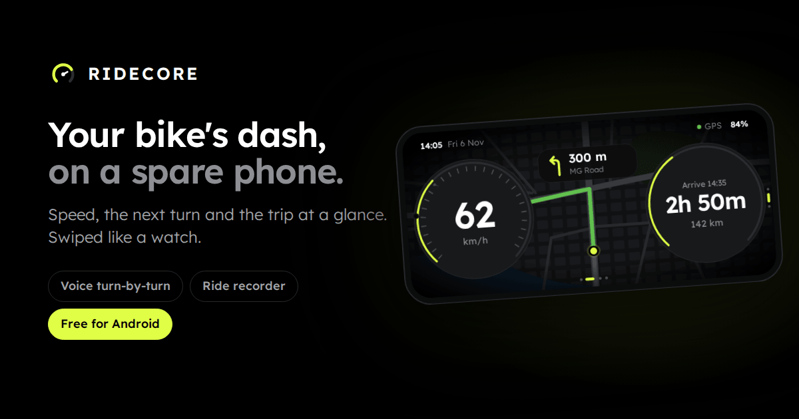

<p align="center">
  
</p>

<h1 align="center">RIDECORE</h1>

<p align="center">
  <strong>Your bike's dash, on a spare phone.</strong><br />
  Free for Android. Early alpha.
</p>

<p align="center">
  <a href="https://praneth2580.github.io/RIDECORE/"></a>
  
  
</p>

<p align="center">
  <a href="https://praneth2580.github.io/RIDECORE/"><strong>Get RIDECORE for Android</strong></a>
  &nbsp;·&nbsp;
  <a href="#set-up-a-riding-phone">Set up a riding phone</a>
</p>

---

RIDECORE turns a phone you keep on the handlebar into a riding device. It becomes that phone's home screen: speed, a map that zooms with you, the next turn and the trip, what's playing and the weather, big enough to read at a glance. There are no buttons to hunt for. You swipe it, like a watch.

## What it does

- **A dash you read at a glance.** Speed in big numbers, the live map with the next turn over it, and the time to go, distance left and arrival beside it. With no trip under way, the same spot shows the ride being recorded, what's playing (tap to pause) or the weather. The top line has the time, heading and temperature, with an umbrella when rain is likely in the next three hours. The phone's state sits in the room the round dials leave in the corners, the way a car's warning lights sit round its gauges: signal bars if there's a SIM (or Wi-Fi, or "Offline"), GPS, a connected helmet headset, and the battery. A word only appears when something's wrong, like "No signal" or "GPS lost". Switch off any part you don't want (Settings → On the dash and Status), and the rest takes its room.
- **A map that rides with you.** It follows you and zooms out as you speed up, back in as you slow down. Settings → Speed zoom picks how far: ×0.5, ×1 or ×1.5. It's dark, in the dash's colours, with your route in green. Tap it to look around.
- **One tap to go again.** Typing on a mount is slow, so your last six places come first on Where to, a tap each. Hold one to forget it. Search is there for somewhere new.
- **Routes for bikes.** Fastest, Shortest or Less traffic, with up to three routes to compare before you start. Expressways closed to two-wheelers stay off unless you allow them. Both choices are kept for the next trip.
- **Voice turn-by-turn.** Prompts timed to your speed, into your helmet headset. Miss a turn and it finds a new route.
- **Turns you see from the corner of your eye.** As a turn comes up, the screen's edge on that side glows lime, brighter as you get closer, and pulses when it's time to turn. Arriving lights both edges green. It starts earlier the faster you ride. Settings → Turn glow switches it off. Routes are worked out on the phone, so once a trip is planned, guidance keeps going when the signal drops.
- **A ride recorder.** One big face: tap it to record, to pause and to carry on, then **Save ride**. It keeps recording with the screen off. Every ride is kept with its shape, distance, moving time and top speed. Or switch on Auto-record and every trip records itself.
- **Music on the ride.** A swipe right of the dash: what any music app on the phone is playing, with big keys to play, pause, go back and skip. Or internet radio in RIDECORE itself: star the stations you like and they come first, then the most played in your country. One plays at a time.
- **A real home screen.** Make RIDECORE the phone's home app. Home always brings the dash back, Back never leaves it, and your music, calls and other apps are a swipe up. Hold an app to pin it to the top.
- **Mounted your way.** Landscape or portrait, chosen the first time you open it and held either way up. The screen stays on all the time, or only while you navigate.
- **Back to the dash on its own.** Leave another screen alone for 30 seconds, or come up to a turn, and the dash returns.

## Swipe it like a watch

Every screen fills the phone. Swipe between them: each snaps into place, and dots show where you are. The dash is home, with a screen on each side of it, where you'd reach for it: everything is one swipe away, Rides two.

```text
                 Settings              pull down from the dash
                    │
   Music  ────    Dash    ────  Where to  ────  Rides
                    │
                  Apps                 swipe up from the dash
```

The way back is always the way you came. Settings and Apps have nothing beside them, so sideways does nothing there; swipe (or tap) the **Dash** handle on their edge to go back, however far down the list you are.

| Screen | What's on it |
| --- | --- |
| **Dash** | Speed, the map with the next turn over it, and the trip. "Where to?" when you're not going anywhere. |
| **Music** | What's playing, with keys to play, pause, go back and skip. Then radio: your starred stations, then the most played. |
| **Where to** | Your last places as keys, then search. While a trip is under way, it's the trip instead: time to go, distance left, arrival, voice on or off, End (tap twice) and the next eight turns. |
| **Rides** | The recorder's big face: tap it to record, pause and carry on, then **Save ride**. Under it, every ride you've recorded, drawn as its shape. Tap one to see it on the map. |
| **Settings** | Big keys, lit when on: what the dash, the top line and the corners show, speed zoom, voice, turn glow, fuel and food on the map, auto-record, screen on, how the phone is mounted, the home app, music info, and the way out to the phone's own settings. |
| **Apps** | The phone's other apps. Tap to open, hold to pin. |

Choosing a route is done stopped. Pick a place and the map takes the whole screen with the routes on offer and **Start**. Scroll down for the route type and expressways.

## Set up a riding phone

1. On the phone, open the [RIDECORE website](https://praneth2580.github.io/RIDECORE/) and tap **Download for Android** (about 10 MB).
2. Open the downloaded file. If Android asks, let your browser install apps (*Install unknown apps*), then tap **Install**.
3. Open RIDECORE, allow location, and pick how the phone sits on the mount: landscape or portrait.
4. Pull down from the dash for Settings, tap **Home app** and choose RIDECORE. Home now brings you to the dash.
5. Mount it and plug it in. The screen stays on, and the battery shows at the top.

RIDECORE isn't on Google Play, so Android may warn you about installing it. It doesn't update itself yet: to update, download the newer file from the website and install it over the one you have. Your rides and settings stay.

## Questions riders ask

<details>
<summary><strong>Is RIDECORE free?</strong></summary>

Yes. There's no account to create and no ads.
</details>

<details>
<summary><strong>Which phones does it run on?</strong></summary>

Android 6.0 or newer, with GPS. There's no iPhone version. An old phone you no longer carry is ideal: RIDECORE is made to be the only thing on it.
</details>

<details>
<summary><strong>Can I still use my other apps?</strong></summary>

Yes. Swipe up from the dash for all of them: tap one to open it, hold one to pin it to the top. Home brings you back to the dash.
</details>

<details>
<summary><strong>How does music work?</strong></summary>

Swipe right from the dash. RIDECORE shows what any music app on the phone is playing, with keys to play, pause, go back and skip. To see the song's name, allow it once in Settings → **Music info**; the keys work without it. Or play internet radio from RIDECORE itself: your starred stations first (hold one to unstar it), then the most played in your country. Only stations that stream over HTTPS are listed. One plays at a time: starting the radio pauses the phone's music, and the other way round.
</details>

<details>
<summary><strong>How do I get my old home screen back?</strong></summary>

Pull down from the dash for Settings and tap **Phone settings**. In Android's settings, open Apps → Default apps → Home app and pick the one you had. The names differ a little from phone to phone.
</details>

<details>
<summary><strong>Does it work without signal?</strong></summary>

Partly. Routes are worked out on the phone, so once a trip is planned, turn-by-turn and voice prompts keep going without a connection. Searching for a place, planning a trip and loading the map for new areas need one.
</details>

<details>
<summary><strong>Is it finished?</strong></summary>

Not yet. RIDECORE is an early alpha: expect rough edges, and please [report what breaks](https://github.com/praneth2580/RIDECORE/issues).
</details>

<details>
<summary><strong>What's TrailCompass?</strong></summary>

RIDECORE's engine. [TrailCompass](https://praneth2580.github.io/TrailCompass/) is a motorcycle navigation app by the same developer. RIDECORE uses its routing, turn-by-turn, voice prompts, GPS and ride recording, and builds its own device around them.
</details>

<details>
<summary><strong>Where do the map and place data come from?</strong></summary>

Maps, roads and search come from OpenStreetMap, through OpenFreeMap, Overpass and Nominatim. Fuel stations and places to eat (Settings → Fuel & food) come from the Overture Maps Foundation and OpenStreetMap. The weather comes from Open-Meteo, and radio stations from Radio Browser.
</details>

<details>
<summary><strong>Does it collect my data?</strong></summary>

There's no account and no analytics. Your rides, places, favourite stations and settings stay on the phone. To show the map, plan routes and search, the app fetches data for the areas you use from the open-data services above. The weather is asked for with your position rounded to about 5 km.
</details>

## Ride safe

RIDECORE is not a certified navigation or safety system. GPS, compass readings and map data can be wrong or missing. Keep a backup way to navigate, follow the road rules, and choose your route before you ride. Don't work the phone while you're moving: it's made to be glanced at.

## Credits

Built on the [TrailCompass](https://github.com/praneth2580/TrailCompass) engine. Map data © [OpenStreetMap contributors](https://www.openstreetmap.org/copyright) · map tiles by [OpenFreeMap](https://openfreemap.org) · places from the [Overture Maps Foundation](https://overturemaps.org) ([sources and licences](public/assets/poi/README.md)) · search by [Nominatim](https://nominatim.org) · roads through the [Overpass API](https://overpass-api.de) · weather data by [Open-Meteo.com](https://open-meteo.com) · radio stations from [Radio Browser](https://www.radio-browser.info).

## For developers

Building RIDECORE or helping out? Start with **[DEVELOPMENT.md](DEVELOPMENT.md)**. The code, screen by screen, is in the **[Project Guide](docs/PROJECT_GUIDE.md)**, and how RIDECORE lives on TrailCompass's engine is in **[ridecore/README.md](ridecore/README.md)**.
